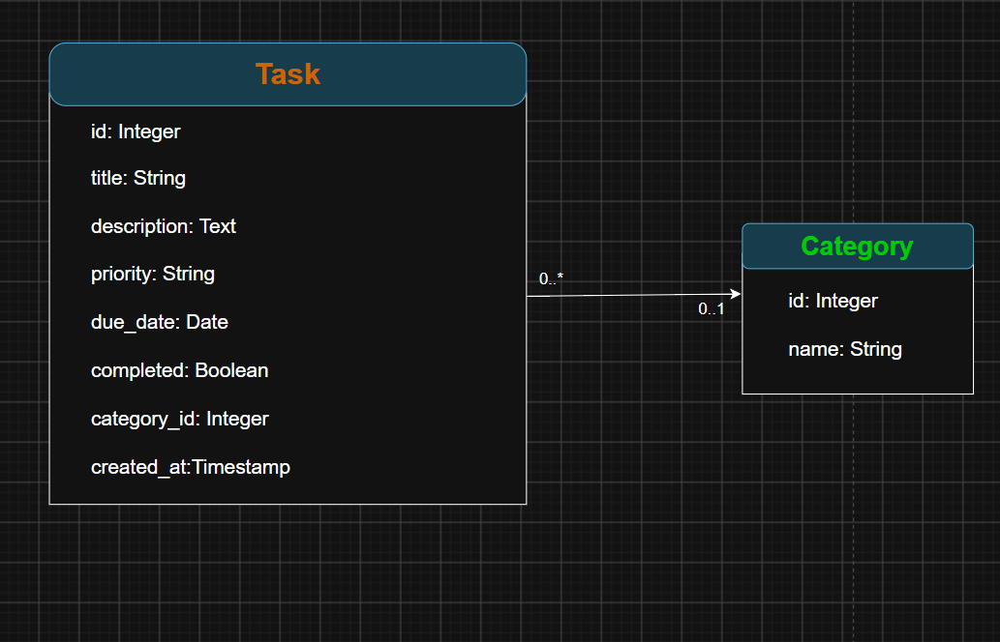

# TaskFlow — Система за управление на задачи

## Описание на проекта

TaskFlow е уеб приложение за управление и организиране на ежедневни задачи. Разработено е с Python и Flask и използва PostgreSQL за съхранение на информацията.

Приложението позволява създаване, преглеждане, редактиране и изтриване на задачи (CRUD операции). Всяка задача може да има описание, приоритет, краен срок, категория и статус.

Потребителят може да търси, филтрира и сортира задачите, както и да управлява собствени категории. Началната страница включва Dashboard със статистика за общия брой задачи, активните, завършените и просрочените задачи.

## Използвани технологии

- **Python 3.13** — основен програмен език.
- **Flask** — framework за разработка на уеб приложението.
- **PostgreSQL** — релационна база данни.
- **HTML, CSS и Jinja2** — потребителски интерфейс и динамични HTML страници.
- **Gunicorn** — WSGI сървър за Flask приложението.
- **Docker и Docker Compose** — контейнеризация и управление на услугите.
- **Nginx** — reverse proxy и разпределяне на заявките между две Flask реплики (Load Balancing).
- **Dozzle** — наблюдение на Docker логовете.
- **OpenSSL** — генериране на самоподписан SSL сертификат за HTTPS.

## Архитектура

Проектът използва пет Docker услуги:

- `db` — PostgreSQL база данни.
- `web1` — първа Flask реплика с Gunicorn.
- `web2` — втора Flask реплика с Gunicorn.
- `nginx` — приема HTTP/HTTPS заявки и ги разпределя между двете реплики.
- `dozzle` — предоставя уеб интерфейс за наблюдение на контейнерите.

Двете Flask реплики използват обща PostgreSQL база данни. Информацията се съхранява в Docker volume `pgdata`, което позволява запазване на данните при спиране на контейнерите.

Основните таблици са `tasks` и `categories`, свързани чрез външен ключ.

## Стартиране на проекта
**1. Клониране на хранилището:**

git clone <URL-на-хранилището>
cd taskflow2

**2. Създаване на конфигурационен файл:**

cp .env.example .env

При необходимост могат да се променят настройките в `.env`, включително паролата за PostgreSQL.

**3. Генериране на SSL сертификат:**

mkdir -p nginx/certs
openssl req -x509 -nodes -days 365 -newkey rsa:2048 \
  -keyout nginx/certs/server.key \
  -out nginx/certs/server.crt \
  -subj "/CN=localhost" \
  -addext "subjectAltName=DNS:localhost,IP:127.0.0.1"
chmod 600 nginx/certs/server.key

**4. Стартиране на контейнерите:**

docker compose up -d --build

При първоначално стартиране PostgreSQL инициализира базата данни чрез SQL скриптовете в проекта.

**5. Спиране на контейнерите:**

docker compose stop

При повторно стартиране на съществуващите контейнери:

docker compose start

## Използвани портове

| Порт | Услуга | Предназначение |
|---|---|---|
| 8000 | Nginx | HTTP достъп до TaskFlow |
| 8443 | Nginx | HTTPS достъп до TaskFlow |
| 8080 | Dozzle | Наблюдение на Docker логовете |
| 8000 (вътрешен) | web1 и web2 | Gunicorn / Flask |
| 5432 (вътрешен) | PostgreSQL | Връзка с базата данни |

Локални адреси:

- HTTP: `http://localhost:8000`
- HTTPS: `https://localhost:8443`
- Dozzle: `http://localhost:8080`

HTTPS използва самоподписан сертификат, затова браузърът може да покаже предупреждение.

## UML диаграма

